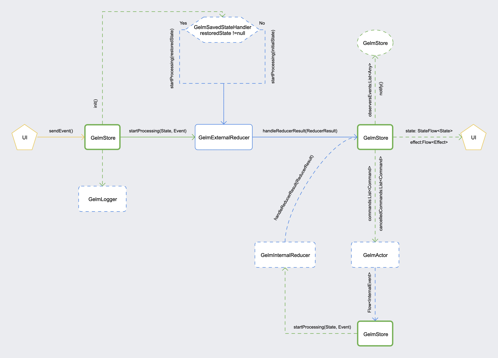

# General

GELM is a **Kotlin Multiplatform (KMP)** library for the popular presentation approach The ELM
Architecture (TEA).

**Targets:** Android, iOS, JVM.

The library standardizes the work with sending and processing synchronous and asynchronous events.
All inputs and outputs to library are strictly defined, which makes it easier to develop and test.

**Version:** 2.0.0.  
**Compile-time dependencies:** `org.jetbrains.androidx.lifecycle:lifecycle-viewmodel` (KMP
ViewModel) and `org.jetbrains.kotlinx:kotlinx-coroutines-core`. Published Gradle module metadata
exposes both dependencies in the API (compile) variants, and platform POMs use compile scope.
`ViewModel`, `Flow`, `StateFlow`, and `CoroutineDispatcher` are part of GELM’s public API, so a
named store subclass compiles without adding these dependencies separately.  
Minimum Kotlin 2.1.x; AGP 8.x. **Android:** compileSdk/targetSdk 36, minSdk 23. For Compose projects
with Kotlin 2.0+,
the [Compose Compiler plugin](https://plugins.gradle.org/plugin/org.jetbrains.kotlin.plugin.compose)
is required in app modules.

**Overriding the lifecycle version.** When conflicting with `androidx.lifecycle` in your app (e.g. a
different ViewModel version), exclude GELM’s transitive dependency and add the desired version
manually:

```kotlin
implementation("io.github.gymbay:gelm:2.0.0") {
    exclude(group = "org.jetbrains.androidx.lifecycle", module = "lifecycle-viewmodel")
}
// then add your preferred version explicitly if needed
implementation("org.jetbrains.androidx.lifecycle:lifecycle-viewmodel:...")
```

**Overriding the coroutines version.** Exclude `kotlinx-coroutines-core` the same way:

```kotlin
implementation("io.github.gymbay:gelm:2.0.0") {
    exclude(group = "org.jetbrains.kotlinx", module = "kotlinx-coroutines-core")
}
// then add your preferred version explicitly if needed
implementation("org.jetbrains.kotlinx:kotlinx-coroutines-core:...")
```

The exclusions apply to both compile-time and runtime classpaths. If you exclude either dependency,
add the replacement explicitly so that GELM’s public types remain available at compile time.

### Gelm architecture schema


# How to implement (Gradle)

Library is published to Maven Central. Add Maven Central to your `settings.gradle.kts`:

```kotlin
pluginManagement {
    repositories {
        mavenCentral()
        google()  // for Android projects
    }
}
dependencyResolutionManagement {
    repositories {
        mavenCentral()
        google()  // for Android projects
    }
}
```

Then add the dependency in your module's `build.gradle.kts`:

- **Android:** `implementation("io.github.gymbay:gelm:2.0.0")` — Gradle will resolve the Android
  variant.
- **iOS (KMP):** the same artifact `io.github.gymbay:gelm:2.0.0` — use the iOS source set of the
  library.
- **JVM:** `implementation("io.github.gymbay:gelm:2.0.0")` — JVM variant.

Example (Android app):

```kotlin
dependencies {
    implementation("io.github.gymbay:gelm:2.0.0")
}
```

# Quick start

This guide helps you to understand how library works.

## Data types

Library works with 5 generic types, some types may be optional.
Optional types can be defined as Kotlin Nothing type.

All types applied in [GelmStore](gelm/src/commonMain/kotlin/io/github/gymbay/gelm/GelmStore.kt).

- **State** (required) - UI representation as some Kotlin type. In general is Data class;
- **Effect** (optional) - one shot event. As example, showing alert in Android view, start timer,
  trigger navigation.
  In general is Enum class;
- **Event** (optional) - some external event
  for [GelmStore](gelm/src/commonMain/kotlin/io/github/gymbay/gelm/GelmStore.kt).
  As example, user initiated event from UI, event from
  another [GelmStore](gelm/src/commonMain/kotlin/io/github/gymbay/gelm/GelmStore.kt). In general is
  Sealed
  or Enum class;
- **Command** (optional) - internal async command
  for [GelmActor](gelm/src/commonMain/kotlin/io/github/gymbay/gelm/GelmActor.kt). May be produced
  from
  external and internal reducer. In example, command for load data from server or save to database;
- **InternalEvent** (optional) - some event from
  internal [GelmActor](gelm/src/commonMain/kotlin/io/github/gymbay/gelm/GelmActor.kt). As example,
  response
  from server or database.

## Main components

Gelm works with 4 main and 2 additional components. In main components only 2 required and others
optional.

Minimum work configuration
required [GelmStore](gelm/src/commonMain/kotlin/io/github/gymbay/gelm/GelmStore.kt)
and [GelmExternalReducer](gelm/src/commonMain/kotlin/io/github/gymbay/gelm/reducers/GelmExternalReducer.kt).

### GelmStore

Central entity for GELM architecture. Holder for architecture components. Responsible for coordinate
flow of external and internal events. Inherited from `ViewModel` (KMP:
`org.jetbrains.androidx.lifecycle:lifecycle-viewmodel`).

```kotlin
import io.github.gymbay.gelm.utils.GelmStore

// Minimum configuration
GelmStore(
  initialState = ExampleState(),
  externalReducer = ExampleExternalReducer()
)
```

For Koin, Navigation 3, or multiple stores in one `ViewModelStore`, use a concrete named subclass
instead. See [Named store subclasses](#named-store-subclasses).

You can pass `Events` from UI to `GelmStore` using `sendEvent(event: Event)` function. All that
event
will be handled by `GelmExternalReducer`.

```kotlin
OutlinedTextField(
  onValueChange = {
    store.sendEvent(ExampleEvent.TypeText(it))
  }
)
```

And then you can observe changes in `State` subscribed on `state: StateFlow<State>`.

```kotlin
val state by store.state.collectAsStateWithLifecycle()

OutlinedTextField(
  value = state.editField,
  onValueChange = {
    store.sendEvent(ExampleEvent.TypeText(it))
  }
)
```

At the end you can use `effect: Flow<Effect>` to observe one-shot events.

```kotlin
// A little life-hack to simplify observing in Compose
@Composable
fun <T> CollectEffect(
  effect: Flow<T>,
  context: CoroutineContext = EmptyCoroutineContext,
  block: (T) -> Unit
) {
  LaunchedEffect(key1 = Unit) {
    effect.onEach(block).flowOn(context).launchIn(this)
  }
}

CollectEffect(store.effect) { effect ->
  when (effect) {
    ExampleEffect.NavigateToScreen -> {
      Toast.makeText(context, "Button tapped!", Toast.LENGTH_LONG).show()
    }
  }
}
```

#### Named store subclasses

Koin and Navigation 3 distinguish ViewModels by their runtime class. A `typealias` does not create a
new runtime type, so declare a concrete named subclass for each screen or feature when the store
must have its own ViewModel or dependency-injection key.

There are two inheritance paths.

**Stores without internal events: the four-type-parameter alias**

```kotlin
import io.github.gymbay.gelm.utils.GelmStore
import io.github.gymbay.gelm.reducers.GelmExternalReducer

class LoginStore : GelmStore<LoginState, LoginEffect, LoginEvent, Nothing>(
    initialState = LoginState(),
    externalReducer = LoginExternalReducer(),
)

class LoginExternalReducer :
    GelmExternalReducer<LoginEvent, LoginState, LoginEffect, Nothing>() {
    // processInit / processEvent
}
```

The alias expands to `GelmStore<State, Effect, Event, Nothing, Command>`, so `InternalEvent` is
fixed to `Nothing` and the store has no actor or internal reducer.

**Stores with internal events: the five-type-parameter class**

```kotlin
import io.github.gymbay.gelm.GelmStore

class ProfileStore : GelmStore<
    ProfileState, ProfileEffect, ProfileEvent, ProfileInternalEvent, ProfileCommand
>(
    initialState = ProfileState(),
    externalReducer = ProfileExternalReducer(),
    actor = ProfileActor(),
    internalReducer = ProfileInternalReducer(),
)
```

The five-type-parameter class is required when an actor and internal reducer are used.

Both forms can be used as a supertype. The typealias itself does not create a distinct runtime type;
the concrete subclass does. A generic application base class also maps to a single runtime class, so
declare one non-generic concrete class per store when distinct keys are required.

The subclass inherits the normal store behavior and adds only a runtime identity. Event handling,
state and effect publication, command execution, and reducer orchestration stay final and cannot be
overridden.

Register the concrete class in Koin with `viewModelOf`:

```kotlin
import org.koin.core.module.dsl.viewModelOf
import org.koin.dsl.module

val loginModule = module {
    viewModelOf(::LoginStore)
}
```

In Navigation 3, install the ViewModel store decorator for your entries and request the concrete
class with `viewModel`:

```kotlin
import androidx.lifecycle.viewmodel.compose.viewModel
import androidx.lifecycle.viewmodel.navigation3.rememberViewModelStoreNavEntryDecorator
import androidx.navigation3.runtime.entryProvider
import androidx.navigation3.runtime.rememberSaveableStateHolderNavEntryDecorator
import androidx.navigation3.ui.NavDisplay

NavDisplay(
    backStack = backStack,
    entryDecorators = listOf(
        rememberSaveableStateHolderNavEntryDecorator(),
        rememberViewModelStoreNavEntryDecorator(),
    ),
    entryProvider = entryProvider {
        entry<LoginRoute> {
            val store: LoginStore = viewModel()
            LoginScreen(store)
        }
    },
)
```

Because the concrete classes are different runtime types, two stores requested from the same
`ViewModelStore` do not collide, and Koin definitions keyed by class remain separate.

Direct creation through the four-type-parameter alias is still supported for simple local stores.
It is fine when a single store is created directly and no DI or navigation framework needs to
distinguish it. Use a concrete subclass as soon as the store is resolved by Koin, Navigation 3, or
another API that keys by runtime class.

### GelmExternalReducer

Reducer is an entity responsible for handling external events (UI or another GelmStore).

The reducer is a pure function, and therefore it should be stateless. Adding stored properties is a
bad
practice.

To define your external reducer you can inherit `GelmExternalReducer` abstract class
and override `processEvent(currentState: State, event: Event)`
or/and `processInit(currentState: State)` functions.

```kotlin
import io.github.gymbay.gelm.reducers.GelmExternalReducer
import io.github.gymbay.gelm.reducers.Modifier

class ExampleExternalReducer :
  GelmExternalReducer<ExampleEvent, ExampleState, ExampleEffect, ExampleCommand>() {

  // Handle GelmStore init. 
  // For example, to mutate state on screen start or start loading.
  override fun Modifier<ExampleState, ExampleEffect, ExampleCommand>.processInit(currentState: ExampleState) {
    TODO()
  }

  // Handle events from UI or another observed GelmStore 
  override fun Modifier<ExampleState, ExampleEffect, ExampleCommand>.processEvent(
    currentState: ExampleState,
    event: ExampleEvent
  ) {
    when (event) {
      ExampleEvent.Reload -> TODO()
      is ExampleEvent.TypeText -> TODO()
      is ExampleEvent.Next -> TODO()
    }
  }

}
```

And then pass reducer to GelmStore

```kotlin
import io.github.gymbay.gelm.utils.GelmStore

GelmStore(
  initialState = ExampleState(),
  externalReducer = ExampleExternalReducer()
)
```

Use `Modifier` in override functions to produce new state, effects and commands. As a result of
reducer work will be produced `ReducerResult` data class. More detailed
in [Modifier and ReducerResult](#modifier-and-reducerresult) section.

On every invoke `GelmStore` passed actual current state and event to reducer. `currentState` is
immutable, state mutations accumulates in `Modifier`.

### GelmActor

Optional entity responsible for handling async or heavy computing commands from reducers. For
example, request to server or database. Component use Flow to publish results with InternalEvent
type.

To define your Actor you can inherit GelmActor abstract class and
override `suspend execute(command: Command): Flow<InternalEvent>` function.

For example:

```kotlin
import io.github.gymbay.gelm.GelmActor

class ExampleActor : GelmActor<ExampleCommand, ExampleInternalEvent>() {
  override suspend fun execute(command: ExampleCommand): Flow<ExampleInternalEvent> = flow {
    when (command) {
      is ExampleCommand.StartLoading -> {
        delay(3.seconds)
        val list = mutableListOf<String>()
        for (i in 1..Random.nextInt(1, 100)) {
          list.add("${command.text} N $i")
        }
        emit(ExampleInternalEvent.LoadedData(list))
      }
    }
  }
}
```

By default all commands executes in `viewModelScope` with `Dispatchers.Default`. If you need another
context use `withContext()` function.

As a result of actor work `GelmStore` received flow of `InternalEvent`.

### GelmInternalReducer

Optional entity. Internal reducer an entity responsible for handling internal events
from `GelmActor`. Must be stateless.

In the sense of `GelmInternalReducer` is an analog of `GelmExternalReducer`, but it works only with
internal events.

To define your internal reducer you can inherit `GelmInternalReducer` abstract class and
override `processInternalEvent(currentState: State, internalEvent: InternalEvent)` function.

```kotlin
class ExampleInternalReducer :
  GelmInternalReducer<ExampleInternalEvent, ExampleState, ExampleEffect, ExampleCommand>() {

  override fun Modifier<ExampleState, ExampleEffect, ExampleCommand>.processInternalEvent(
    currentState: ExampleState,
    internalEvent: ExampleInternalEvent
  ) {
    when (internalEvent) {
      is ExampleInternalEvent.LoadedData -> TODO()
    }
  }

}
```

Using `GelmInternalReducer` make sense only with `GelmActor`, so store defining will be looks like:

```kotlin
GelmStore(
  initialState = ExampleState(),
  externalReducer = ExampleExternalReducer(),
  actor = ExampleActor(),
  internalReducer = ExampleInternalReducer()
)
```

On every invoke `GelmStore` passed actual current state and internal event to
reducer. `currentState` is
immutable, state mutations accumulates in `Modifier`.

### Modifier and ReducerResult

[Modifier](gelm/src/commonMain/kotlin/io/github/gymbay/gelm/reducers/GelmModifier.kt) and
[ReducerResult](gelm/src/commonMain/kotlin/io/github/gymbay/gelm/reducers/ReducerResult.kt)
is a core classes for reducers used in processing events functions.

`Modifier` provides functions for state changing, produce effects, commands, events to subscribed
stores and cancel long work commands.

As a result of `Modifier` work always be `ReducerResult`. `ReducerResult` contains all state changes
and produced commands, events and etc.

Let's take a closer look at what functions the `Modifier` provides and what its typical use looks
like:

#### Function `state(modify: State.() -> State)`

Function for state modifications. Function provides `State` lambda scope and expect new state on
return.
Typical approach for state modification in Kotlin is using `copy()` function on data classes.
Example of use:

```kotlin
data class State(val loadedCount: Int = 0)

class TestExternalReducer : GelmExternalReducer<Nothing, State, Effect, Nothing>() {
  override fun Modifier<State, Effect, Nothing>.processInit(currentState: State) {
    val newLoadedCount = currentState.loadedCount + 1
    state { copy(loadedCount = newLoadedCount) }
  }
}

val reducerResult = TestExternalReducer().processInit(State())

assertEquals(State(loadedCount = 1), reducerResult.state)
```

#### Function `effect(newEffect: Effect)`

Function for producing new `Effects` after reducer work. Each time the function is called,
the `Modifier` adds a new value to the `internalEffects` mutable list.

```kotlin
class TestExternalReducer : GelmExternalReducer<Nothing, Unit, Effect, Nothing>() {
  override fun Modifier<Unit, Effect, Nothing>.processInit(currentState: Unit) {
    effect(Effect.Alert)
    effect(Effect.Toast)
    effect(Effect.Navigation)
  }
}

val reducerResult = TestExternalReducer().processInit(Unit)

assertEquals(3, reducerResult.effects.size)
```

#### Function `command(newCommand: Command)`

Function for producing async commands to `GelmActor`. Each time the function is called,
the `Modifier` adds a new value to the `internalCommands` mutable list.

```kotlin
class TestExternalReducer : GelmExternalReducer<Nothing, Unit, Nothing, Command>() {
  override fun Modifier<Unit, Nothing, Command>.processInit(currentState: Unit) {
    command(Command.LoadClient)
    command(Command.LoadProducts)
  }
}

val reducerResult = TestExternalReducer().processInit(Unit)

assertEquals(2, reducerResult.commands.size)
```

#### Function `cancelCommand(command: Command)`

Function for cancelling long work command in `GelmActor`. For example, long computation than might
be cancelled when user tap `Cancel` button.

```kotlin
class TestExternalReducer : GelmExternalReducer<Nothing, Unit, Nothing, Command>() {
  override fun Modifier<Unit, Nothing, Command>.processInit(currentState: Unit) {
    cancelCommand(Command.LoadClient)
    cancelCommand(Command.LoadProducts)
  }
}

val reducerResult = TestExternalReducer().processInit(Unit)

assertEquals(2, reducerResult.cancelledCommands.size)
```

#### Function `event(event: ObserverEvent)`

Function for sending untyped events that might be handled by subscribed `GelmStore`. Use when you
need make interaction with another `GelmStore`.

```kotlin
// Reducer that will be sending event to another store
private class InitialExternalReducer :
  GelmExternalReducer<InitialEvent, Unit, Nothing, Nothing>() {
  override fun Modifier<Unit, Nothing, Nothing>.processEvent(
    currentState: Unit,
    event: InitialEvent
  ) {
    when (event) {
      is InitialEvent.StartDelegation -> event(DelegationEvent.Data(title = event.title))
    }
  }
}

// Reducer that will be receiving event from another store
private class DelegationExternalReducer :
  GelmExternalReducer<DelegationEvent, DelegationState, Nothing, Nothing>() {
  override fun Modifier<DelegationState, Nothing, Nothing>.processEvent(
    currentState: DelegationState,
    event: DelegationEvent
  ) {
    when (event) {
      is DelegationEvent.Data -> state { copy(title = event.title) }
    }
  }
}

// Implementation logic
val initialStore = GelmStore<Unit, Nothing, InitialEvent, Nothing, Nothing>(
  initialState = Unit,
  externalReducer = InitialExternalReducer(),
  commandsDispatcher = StandardTestDispatcher(testScheduler)
)

val delegationStore = GelmStore<DelegationState, Nothing, DelegationEvent, Nothing, Nothing>(
  initialState = DelegationState(),
  externalReducer = DelegationExternalReducer(),
)

// Subscribe delegationStore to initialStore
initialStore.subscribe(delegationStore)
assertNull(delegationStore.state.first().title)

val newTitle = "initial"
initialStore.sendEvent(InitialEvent.StartDelegation(title = newTitle))
advanceUntilIdle()

assertEquals(DelegationState(title = newTitle), delegationStore.state.first())
```

## Additional components

`GelmStore` provides some additional functionality to debugging and state handling.

### GelmSavedStateHandler

If you need your `State` to survive the system process death event,
use [GelmSavedStateHandler](gelm/src/commonMain/kotlin/io/github/gymbay/gelm/utils/GelmSavedStateHandler.kt)
interface.

`GelmSavedStateHandler` interface provides two functions:

- `saveState(state: State)` for saving state into long living storage. Invokes on each state
  changing. Works on main thread;
- `restoreState(initialState: State): State?` for restoring state from long living storage. Works on
  init phase of `GelmStore` on main thread.

```kotlin
val savedStateHandler = object : GelmSavedStateHandler<ExampleState> {
  override fun saveState(state: ExampleState) {
    TODO()
  }

  override fun restoreState(initialState: ExampleState): ExampleState? {
    TODO()
  }
}

GelmStore(
  initialState = ExampleState(),
  externalReducer = ExampleExternalReducer(),
  actor = ExampleActor(),
  internalReducer = ExampleInternalReducer(),
  savedStateHandler = savedStateHandler
)
```

### GelmLogger

For debugging might be useful
using [GelmLogger](gelm/src/commonMain/kotlin/io/github/gymbay/gelm/utils/GelmLogger.kt).
`GelmLogger` provides `log(eventType: EventType, message: String)` function for log `GelmStore`
lifecycle events.
You can use standard log output or analytics in overrides of log function.

Example of use:

```kotlin
GelmStore(
  logger = { eventType, message -> println("$eventType = $message") }
)
```

Now `GelmLogger` supports
10 [EventTypes](gelm/src/commonMain/kotlin/io/github/gymbay/gelm/utils/GelmLogger.kt). Name of event
determine what will be logged.

# How to test

All components in Gelm covered tests and no need to retest on user side.

On user side might be tested custom architecture components inherited from:

- GelmExternalReducer
- GelmInternalReducer
- GelmActor

The library offers a standardized approach to testing architectural components.

## Test GelmExternalReducer

Because  `GelmExternalReducer` stateless component it might be tested like pure function with
determined inputs and outputs.

Typical test looks like:

```kotlin
@Test
fun testReloadEvent() {
  val inputText = "Text"

  val reducer = ExampleExternalReducer()
  val result = reducer.startProcessing(
    state = ExampleState(editField = inputText),
    event = ExampleEvent.Reload
  )

  // state
  assertEquals(
    ExampleState(
      editField = inputText,
      isLoading = true
    ),
    result.state
  )
  // effects
  assertTrue(result.effects.isEmpty())
  // commands
  assertTrue(result.commands.size == 1)
  assertEquals(
    ExampleCommand.StartLoading(text = inputText),
    result.commands.first()
  )
  // cancelled commands
  assertTrue(result.cancelledCommands.isEmpty())
  // observer events
  assertTrue(result.observersEvents.isEmpty())
}
```

Each test might be invoke `startProcessing` function in reducer with specific `Event` and `State`.
And then assert `ReducerResult` output that contains five standardized variables.

That approach guarantee that test will be stable and check all logic.

Additional approach for stable test is using default values in `State`.
This ensures that if you add a new value to `State`, then most of the tests will not require
correction.

## Test GelmInternalReducer

Testing approach for `GelmInternalReducer` is the same as for `GelmExternalReducer`.

## Test GelmActor

`GelmActor` might be stateless component with external dependencies (for example, use cases,
repositories and etc).
All actor external dependencies must be replaced by fakes.

So, typical test on `GelmActor` will be looks like:

```kotlin
import kotlinx.coroutines.flow.toList
import kotlinx.coroutines.test.runTest

@Test
fun testStartLoading() = runTest {
  val inputText = "test"
  val sut = ExampleActor()

  val events = mutableListOf<ExampleInternalEvent>()
  sut.execute(ExampleCommand.StartLoading(text = inputText)).toList(events)

  assertEquals(1, events.size)
  val items = (events[0] as ExampleInternalEvent.LoadedData).list
  assertTrue(items.isNotEmpty())
  assertTrue(items.all { it.contains(inputText) })
}
```

We need to invoke `execute()` with specific variant of `Command` (input) and then check all produced
events from `Flow` (output).

Thus, you need to consistently check all `Commands` and resulting events for a full covered test.

# iOS demo

The project includes an iOS demo module `iosDemo` that consumes GELM on iOS (Kotlin/Native). It
shows the same usage pattern as the Android app: store creation, state/effect subscription, sending
events.

**Requirements:** Xcode, macOS, Kotlin/Native toolchain (installed by Gradle).

**Run:** Build iOS framework: `./gradlew :iosDemo:linkReleaseFrameworkIosArm64` (device) or
`:iosDemo:linkReleaseFrameworkIosSimulatorArm64` (simulator). To run on simulator/device, use Xcode
with the iOS app target.

# Build verification (KMP)

To verify all targets and the app build:

```bash
# Library: all targets
./gradlew :gelm:compileReleaseKotlinAndroid :gelm:compileKotlinJvm :gelm:compileKotlinIosArm64 :gelm:compileKotlinIosX64

# Unit tests (Android)
./gradlew :gelm:testDebugUnitTest :gelm:testReleaseUnitTest

# Android app
./gradlew :app:assembleDebug

# iOS demo (framework)
./gradlew :iosDemo:linkReleaseFrameworkIosArm64
```

Full build: `./gradlew :gelm:build :app:assembleDebug`